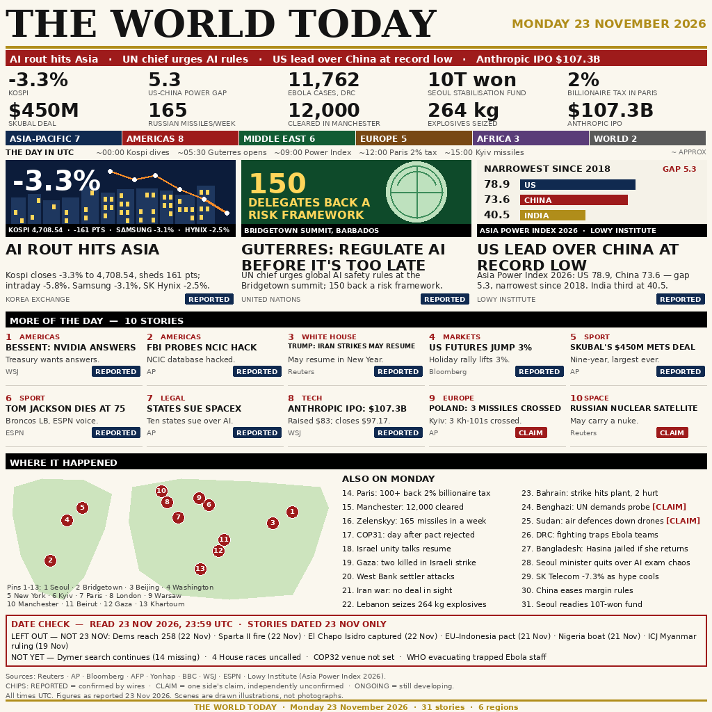

[](https://make.fun/bounty/news-image-20261123?utm_source=github&utm_medium=readme&utm_campaign=news-image-20261123)
[](https://make.fun/bounty/news-image-20261123/leaderboard?utm_source=github&utm_medium=readme&utm_campaign=news-image-20261123)
[](https://make.fun/bounty/news-image-20261123?utm_source=github&utm_medium=readme&utm_campaign=news-image-20261123)

# THE WORLD TODAY — Monday 23 November 2026

One image summing up 23 November 2026's world news, for the make.fun
news-image-20261123 bounty ("Sum up 23 November's world news in one image").



## What's in the image

- **Heroes:** the AI rout hits Asia (Kospi −3.3%), Guterres urging AI rules at the
  Bridgetown summit, and the US lead over China at a record low (Asia Power Index
  2026: US 78.9, China 73.6, gap 5.3).
- **Number strip:** −3.3% Kospi · 5.3 gap · 11,762 Ebola cases in the DRC ·
  10T-won Seoul fund · 2% billionaire tax · $450M Skubal deal · 165 Russian
  missiles/week · 12,000 cleared in Manchester · 264 kg explosives seized ·
  $107.3B Anthropic IPO.
- **10 more stories**, a world map with 13 numbered pins, and an 18-item
  "ALSO ON MONDAY" list — 31 stories in total, across 6 regions.
- **DATE CHECK box:** stories from other dates are listed there only, never as
  news — Dems reaching 258, the Sparta II fire, and the El Chapo Isidro capture
  (22 Nov), the EU–Indonesia pact and the Nigeria boat (21 Nov), and the ICJ
  Myanmar ruling (19 Nov).

Chips: REPORTED = confirmed by wires; CLAIM = one side's claim, independently
unconfirmed. Scenes are drawn illustrations, not photographs. All times UTC.

## How it works

- `draw.py` renders `entry.png` (1024×1024) with Pillow.
- `main.py` is the entrypoint: stdlib only, it validates the PNG (signature,
  IHDR 1024×1024, chunk CRCs, IEND last) and copies it to
  `$MAKEFUN_OUTPUT_DIR/entry.png`.

```sh
python3 draw.py
MAKEFUN_OUTPUT_DIR=out python3 main.py
```
